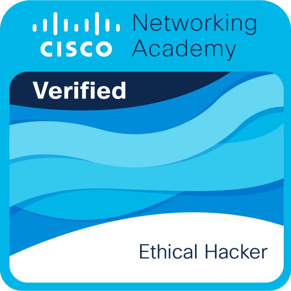
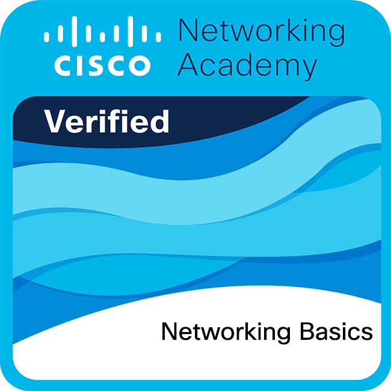
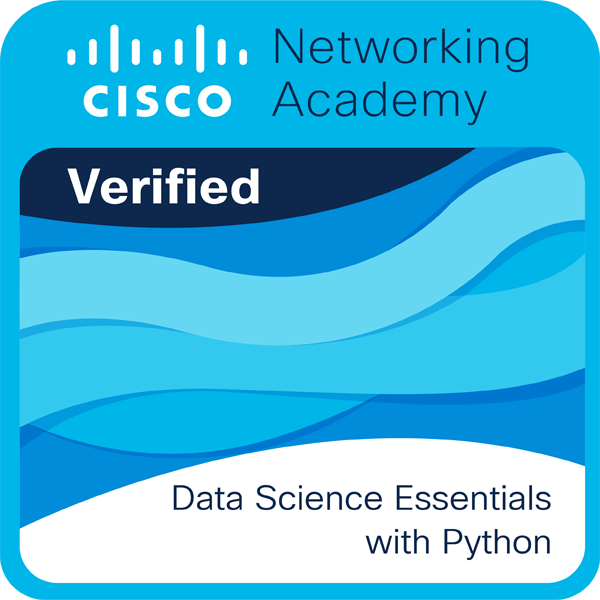

  

  

  

## 📌 About Me
- 🎓 University Student
- 🚀 Now building my first game.

---

## 🎮 Gaming Trackers

  

---

## 🛠 Tech Stack / Skills

Languages & Scripting: 
&nbsp;
&nbsp;
&nbsp;
&nbsp;
&nbsp;
&nbsp;
&nbsp;
&nbsp; 

Frontend: 
&nbsp;
&nbsp;
&nbsp;
&nbsp;
&nbsp; 

Backend & Database: 
&nbsp;
&nbsp; 

---

## 🛠️ Certification Badges 🪶

  
  &nbsp;&nbsp;&nbsp;&nbsp;
  
  &nbsp;&nbsp;&nbsp;&nbsp;
  

---

## 🔗 Connect with Me

  &nbsp;&nbsp;&nbsp;&nbsp;
  

  

  

